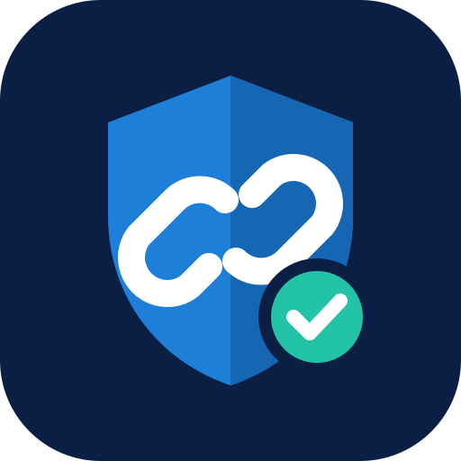
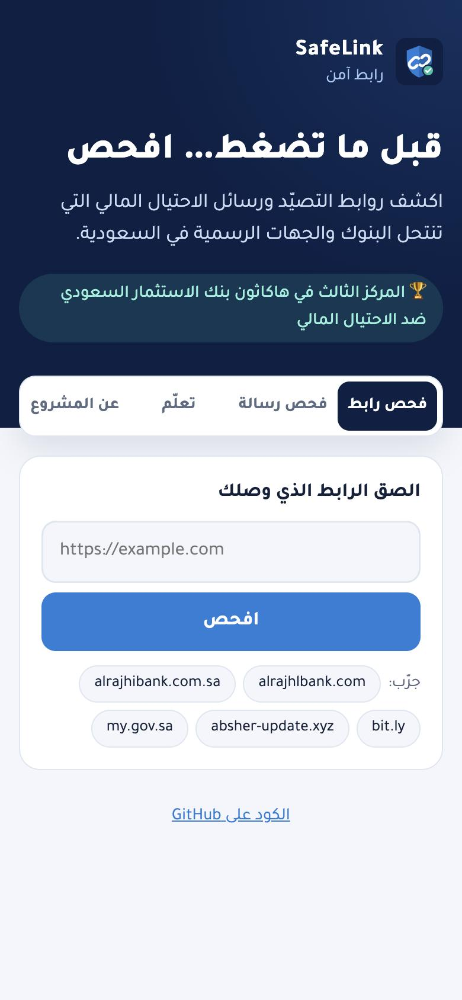
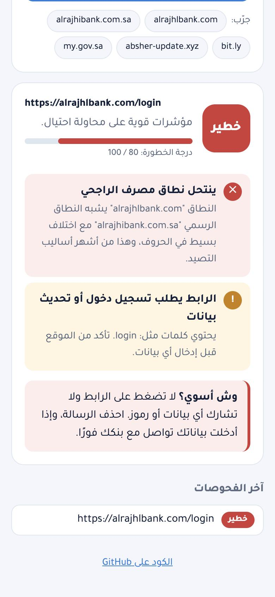
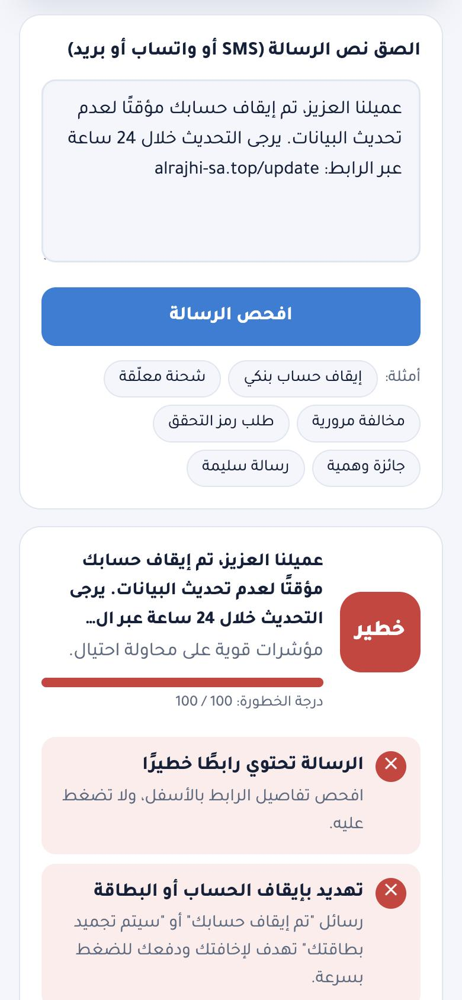

<div align="center">



# SafeLink · رابط آمن

**Detect phishing links and scam messages that impersonate banks and government services in Saudi Arabia.**

اكشف روابط التصيّد ورسائل الاحتيال المالي التي تنتحل البنوك والجهات الرسمية، قبل أن تضغط.

🏆 **3rd place, Saudi Investment Bank (SAIB) Hackathon Against Financial Fraud**

[**▶ Try it live**](https://muniraalzughaibi.github.io/safelink/)

[](https://github.com/MuniraAlzughaibi/safelink/actions/workflows/ci.yml)


</div>

---

<p align="center">
  
  
  
</p>

## The problem

Scam SMS and WhatsApp messages in Saudi Arabia copy the tone and branding of banks, Absher, Saudi Post and payment apps: *"your account has been suspended"*, *"pay a 9 SAR delivery fee"*, *"send us the code you received"*. The fake links often differ from the real domain by a single letter. SafeLink makes those signals visible in one tap, and explains **why** something is risky.

## Features

### 🔗 Link scanner
Paste a link and get **Safe / Suspicious / Dangerous** with a risk score and a reason for every finding:
- **Official domain check** against the real domains of Saudi banks, payment providers and government services (any `*.gov.sa` is recognised as government).
- **Typo-squatting detection**: `alrajhlbank.com` or `a1rajhibank.com.sa` vs the real `alrajhibank.com.sa`, using edit distance plus look-alike character normalisation (`0→o`, `1→l`, `rn→m`).
- **Brand impersonation**: an organisation's name on a domain it doesn't own (`absher-update.xyz`, `spl-delivery.icu`).
- **Technical tricks**: URL shorteners, raw IP addresses, the `@` userinfo trick, punycode/homoglyph hosts, abused TLDs, non-standard ports, plain HTTP, deep subdomain chains.

### 💬 Message scanner
Paste an SMS, WhatsApp or email message. SafeLink:
- Detects common **scam tactics** in Arabic and English: asking for the OTP, account-suspension threats, "update your data" requests, urgency, fake prizes, parcel fees, fines, refunds and "guaranteed profit" investments.
- **Normalises Arabic text** (hamza forms, taa marbuta, diacritics, tatweel) so variants still match.
- **Avoids false alarms** on genuine OTP messages that warn *"don't share this code"*.
- Extracts every link in the message and scans each one.

### 🛡️ Awareness
Practical tips and realistic sample scams that can be scanned with one tap.

### 🔒 Private by design
All analysis runs **in the browser**. No link or message ever leaves the device. It also works **offline** and can be installed to the home screen (PWA).

## How the score works

Each finding carries a weight. The total (capped at 100) gives the verdict:

| Score | Verdict |
|---|---|
| 0–24 | ✅ Safe (no known signals; still verify the sender) |
| 25–59 | ⚠️ Suspicious |
| 60–100 | ⛔ Dangerous |

A single decisive signal (a look-alike bank domain, the `@` trick, a request to send the OTP) is enough on its own to reach *Dangerous*. Rules are explicit and explainable rather than a black box, so every verdict comes with its reasons.

## Tech

```
src/
├── analyzer/   url.ts (link rules) · message.ts (scam patterns) · types.ts (scoring)
├── data/       official domains, shorteners, risky TLDs, sample messages
├── ui/         result rendering
└── main.ts     tabs, scanning, recent-scan history
tests/          Vitest suites for both analyzers
```

- **TypeScript + Vite**, no runtime dependencies (~9 KB of JS gzipped).
- **21 unit tests** covering official domains, typo-squatting, impersonation, tricks, scam patterns and false-positive cases.
- **CI/CD with GitHub Actions**: every push type-checks and runs the tests; pushes to `main` build and deploy to GitHub Pages automatically.
- Arabic-first RTL interface with light and dark mode, and a bundled Tajawal font.

```bash
npm install
npm run dev     # local development
npm test        # run the test suite
npm run build   # production build
```

## Team: PForce

Built at the **Saudi Investment Bank Hackathon Against Financial Fraud**, where the team won **3rd place**.

| Member | Role |
|---|---|
| **Manal Alfahmi** · منال الفهمي | Team lead, idea owner, content |
| **Rand Alammash** · رند العماش | Idea development, design, content |
| **Malaa Aldhubaiti** · ملاء الضبيطي | Content, presentation, pitching |
| **Rawan Alali** · روان العلي | Presentation, content, pitching, design |
| **Munira Alzughaibi** · منيرة الزغيبي | App developer, pitching; built this web version |

## Disclaimer

SafeLink is an awareness tool that highlights common warning signs. It cannot guarantee that any site is safe. When in doubt, contact the organisation through its official app or phone number.
